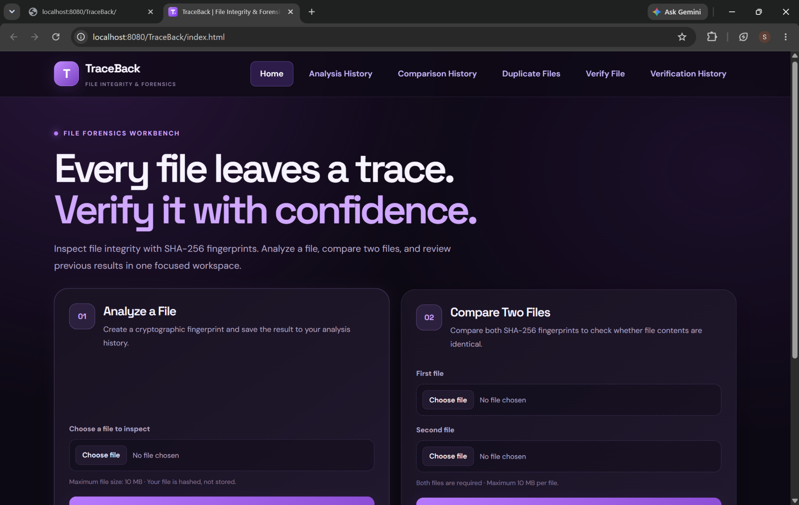
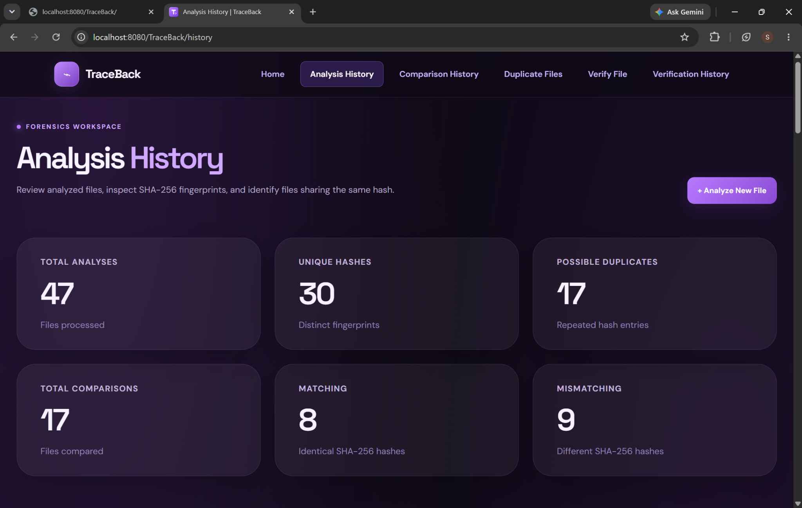
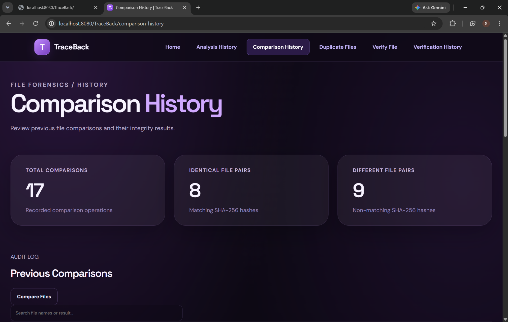
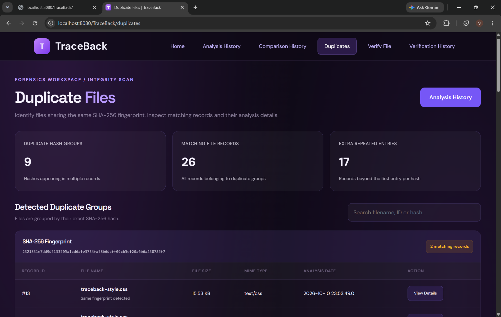
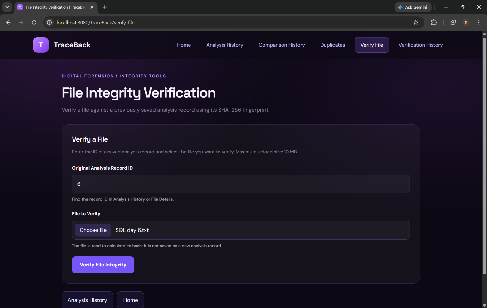
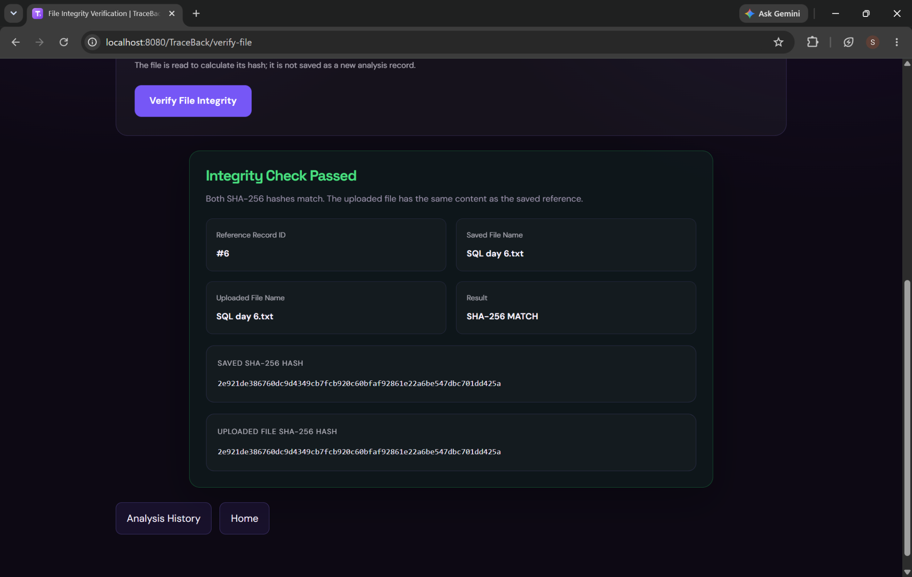
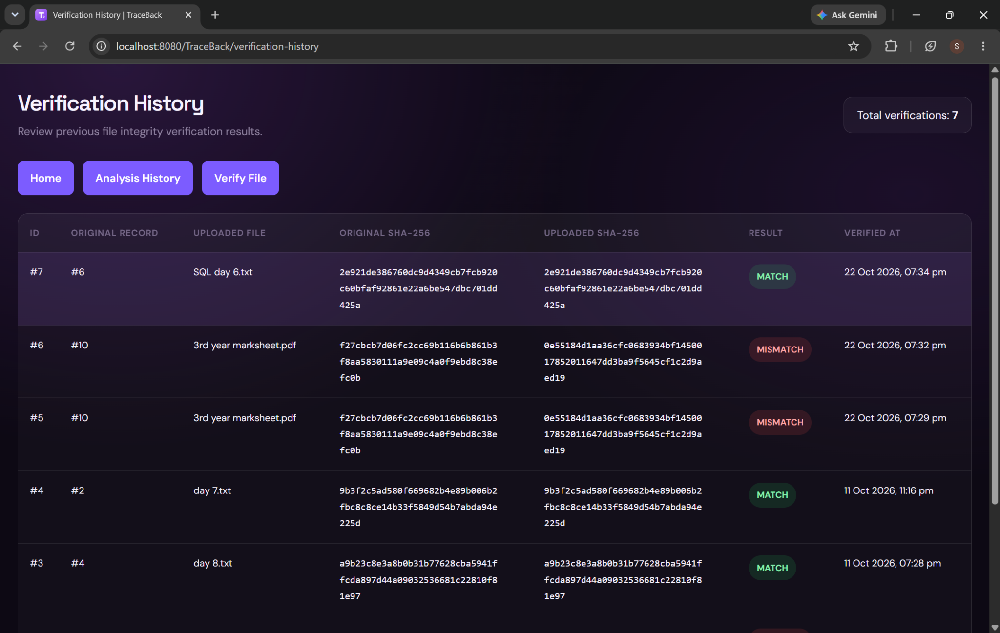

# TraceBack — File Integrity & Forensics Workbench

TraceBack is a web-based file integrity and digital forensics workbench that uses **SHA-256 cryptographic hashes** to analyze files, compare file contents, identify duplicate records, and verify files against previously saved references.

## Features

- **File analysis:** Calculate a file's SHA-256 fingerprint and save its analysis record.
- **File comparison:** Compare two files by their SHA-256 hashes to check whether their contents are identical.
- **Analysis history:** Review analyzed files, fingerprints, and recorded analysis results.
- **Duplicate detection:** Find records that share the same SHA-256 fingerprint.
- **File integrity verification:** Compare an uploaded file's hash against a saved analysis record and show a match or mismatch result.
- **Comparison history:** Review previous file comparisons and their outcomes.
- **Verification history:** Review previous integrity verification results.
- **Upload limit:** The UI indicates a maximum upload size of 10 MB per file.

## Screenshots

### Home Dashboard

### Analysis History

### Comparison History

### Duplicate File Detection

### Verify File

### Integrity Verification Result

### Verification History

## Technology Stack

- **Frontend:** HTML, CSS, JavaScript
- **Backend:** Java Servlets and JSP
- **Database access:** JDBC
- **Database:** MySQL
- **Application server:** Apache Tomcat 10.1
- **Integrity algorithm:** SHA-256
- **Development environment:** Eclipse IDE

## How It Works

1. A user uploads a file for analysis.
2. TraceBack calculates the file's SHA-256 hash.
3. The analysis metadata and hash are saved as a database record.
4. For comparison, the application calculates the hashes of two uploaded files and compares them.
5. For verification, the application compares an uploaded file's hash with the hash stored in a selected reference record.
6. Results can be reviewed later in the corresponding history pages.

> **Note:** SHA-256 equality is used to check whether file contents match. A matching hash is strong evidence that the contents are identical; it is not a substitute for a complete forensic chain-of-custody process.

## Local Setup

These are general setup steps for the current Servlet/JSP application. Use the database name and table definitions configured in your project.

1. Install a compatible JDK, Apache Tomcat 10.1, and MySQL.
2. Create the MySQL database used by the application (the local project has been configured to use `traceback_db`).
3. Configure database connection settings for your environment. Do not commit passwords or other secrets to GitHub.
4. Import or create the database tables required by the DAO classes.
5. Import the project into Eclipse as a Dynamic Web Project, configure Tomcat 10.1, and ensure the MySQL JDBC and PDF-library dependencies are available.
6. Run the project on Tomcat and open the deployed application URL in your browser.

## Security Notes

- Do not commit database passwords, API keys, or other credentials.
- The home page indicates that analyzed file contents are hashed, not stored by the analysis flow.
- Review database configuration and upload validation before exposing the application to the public internet.

## Project Status

TraceBack is a learning and portfolio project demonstrating file hashing, integrity checks, file comparison, duplicate detection, and history tracking using Java web technologies.
